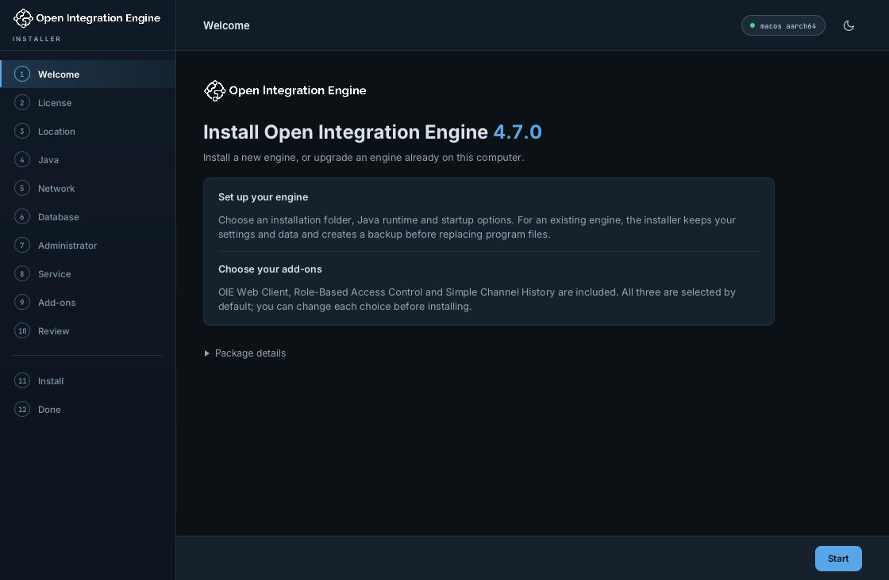
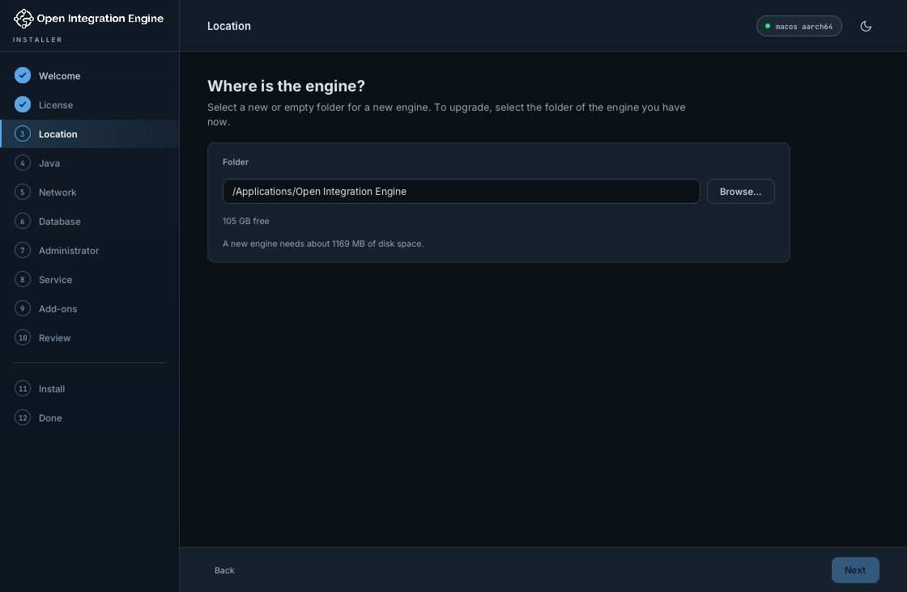
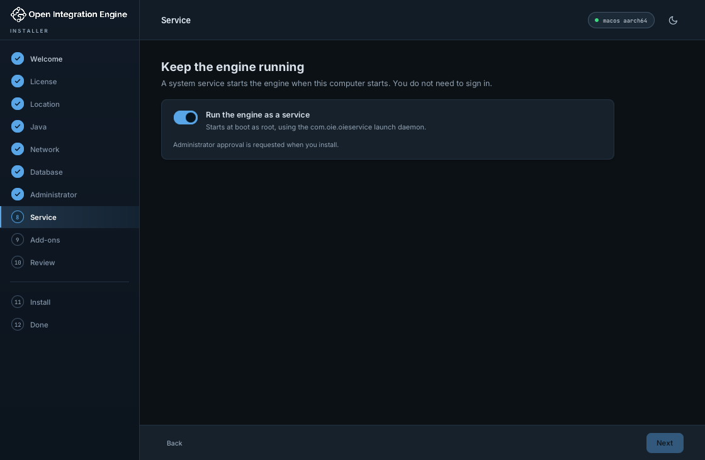
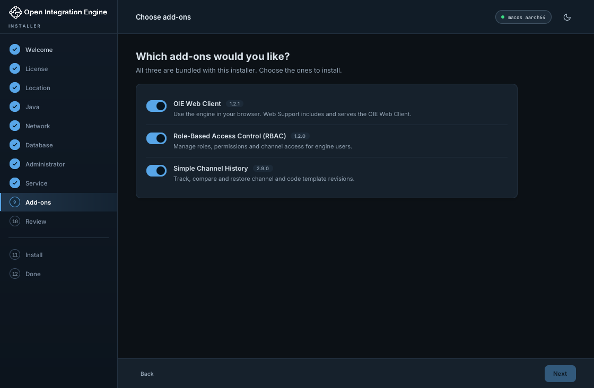
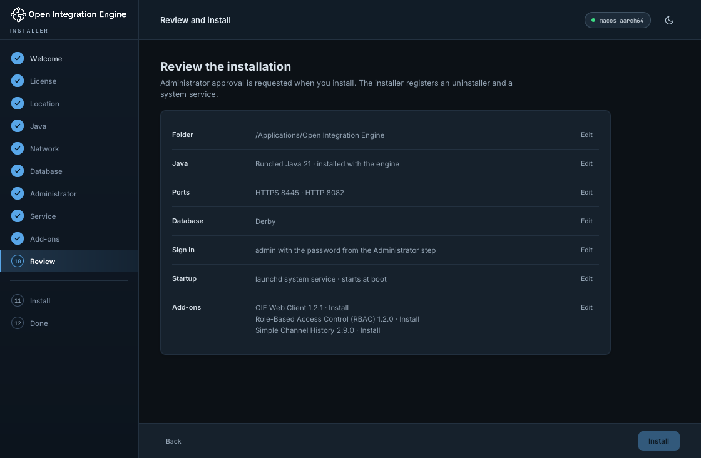
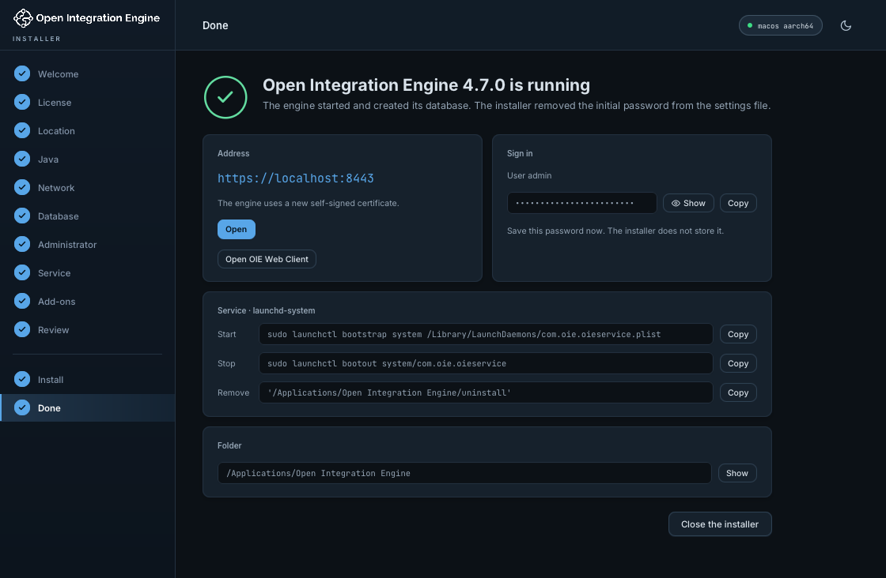

# Open Integration Engine Installer

The Open Integration Engine Installer installs, upgrades and removes Open Integration Engine (OIE) on Windows, macOS and Linux.

The installer uses JavaFX for its desktop wizard and `jpackage` for its application runtime and native launchers. The build compiles the engine from its release tag with Gradle. Each package contains the engine and optional add-ons. Installation runs without downloading additional files.



## Packages

The build produces two packages for each platform:

- **With Java:** includes a Java 21 runtime for the engine. The filename includes `-with-JRE`.
- **Without engine Java:** uses an installed Java 17 or later. The installer and its launchers include their own application runtimes.

| Platform | Without engine Java | With Java |
| --- | --- | --- |
| Windows x64 | `oie_windows-x64_<version>.exe` | `oie_windows-x64_<version>-with-JRE.exe` |
| Windows ARM64 | `oie_windows-arm64_<version>.exe` | `oie_windows-arm64_<version>-with-JRE.exe` |
| macOS Apple silicon | `oie_macos_<version>-aarch.dmg` | `oie_macos_<version>-aarch-with-JRE.dmg` |
| macOS Intel | `oie_macos_<version>-x86.dmg` | `oie_macos_<version>-x86-with-JRE.dmg` |
| Linux x64 | `oie_unix_<version>.sh` | `oie_unix_<version>-with-JRE.sh` |
| Linux ARM64 | `oie_unix_<version>-aarch64.sh` | `oie_unix_<version>-aarch64-with-JRE.sh` |

`<version>` uses underscores, for example `4_7_0`. Each package has a `.sha256` checksum file.

The build also produces engine archives without an installer:

| Platform | Archive |
| --- | --- |
| Windows x64 | `oie_windows-x64_<version>.zip` |
| Windows ARM64 | `oie_windows-arm64_<version>.zip` |
| Linux x64 | `oie_unix_<version>.tar.gz` |
| Linux ARM64 | `oie_unix_<version>-aarch64.tar.gz` |

See [Engine archives](#engine-archives).

macOS packages use ad hoc signing. Windows packages are unsigned.

## Install

1. Start the package for your operating system:
   - Windows: run the `.exe`.
   - macOS: open the `.dmg`, then open **Open Integration Engine Installer**.
   - Linux: run `sh oie_unix_<version>-with-JRE.sh` from a desktop session. In a terminal, it asks for your password through `sudo`. Started from a file manager, it uses the desktop's administrator prompt (`pkexec`).
2. Read the license and select **I accept**.
3. Select the engine folder.
4. Select the Java runtime for the engine.
5. Set the network ports and database.
6. Generate an administrator password or enter one with at least 15 characters.
7. Select **Run the engine as a service** to start it at boot. Clear this option to run it as a normal process.
8. Select the add-ons.
9. Check the settings on the review screen and select **Install**.
10. Approve the request for administrator access when prompted.

On Linux, browser and folder actions use the desktop session of the user who started the installer. These actions require `xdg-open` from `xdg-utils` and `setpriv` from `util-linux`.






The installer verifies each bundled file against its SHA-256 hash. It then installs the engine files, selected add-ons, launchers and uninstaller. Service installations also register a system service.

The installer starts the engine and waits for two startup checks:

- A new `server successfully started` entry in `logs/mirth.log`.
- An open HTTPS port.

The completion screen shows the engine address, installation folder and administrator credentials. Save the generated password before closing the installer.



### Database and administrator account

New installations support Derby, PostgreSQL, MySQL, Microsoft SQL Server and Oracle. External databases require a JDBC URL and database credentials.

The engine applies the initial administrator password when it creates the database. The installer supplies this password through `server.initialadminpassword` in `conf/mirth.properties`. It removes the setting after the startup check, including when startup fails.

### Add-ons

These add-ons are bundled and selected by default:

- **OIE Web Client:** provides the web administrator through the Web Support add-on at `/oie-webadmin/`.
- **Role-Based Access Control (RBAC):** provides role and permission management.
- **Simple Channel History:** records channel revisions.

The review screen shows the version of each selected add-on.

### Text mode

Use `-c` to answer the installer's questions in a terminal. Linux uses text mode when no desktop is available.

```bash
sudo sh oie_unix_4_7_0-with-JRE.sh -c
```

Text mode asks the same questions as the wizard. Press Enter to accept the value in brackets. Add `-dir <folder>` to set the suggested engine folder.

### Unattended installation

Use `-q` to install with the default settings. Run the command as an administrator.

```bash
# Linux
sudo sh oie_unix_4_7_0-with-JRE.sh -q -dir /opt/openintegrationengine

# macOS: mount the disk image, then run the application inside it
sudo "/Volumes/Open Integration Engine Installer/Open Integration Engine Installer.app/Contents/MacOS/Open Integration Engine Installer" -q -dir /Applications/OpenIntegrationEngine
```

```powershell
# Windows, from an elevated prompt
Start-Process -Wait .\oie_windows-x64_4_7_0-with-JRE.exe -ArgumentList '-q','-dir','C:\Program Files\OpenIntegrationEngine'
```

The Linux package checks its SHA-256 hash before it unpacks. It unpacks to `/var/tmp`, or to `TMPDIR` when set.

This command uses Derby and selects available HTTP and HTTPS ports, starting at 8080 and 8443. It selects all bundled add-ons and registers a service when supported. The output includes the generated administrator password.

For custom settings, save an installation plan as JSON:

```json
{
  "installDir": "/opt/openintegrationengine",
  "javaCmd": "@bundled",
  "httpPort": 8080,
  "httpsPort": 8443,
  "database": "derby",
  "adminPassword": "replace-with-a-long-unique-password",
  "service": true,
  "plugins": {
    "websupport": true,
    "rbac": true,
    "simple-channel-history": true
  }
}
```

Run the installer with the plan. Each package accepts `--unattended`:

```bash
sudo sh oie_unix_4_7_0-with-JRE.sh --unattended /path/to/plan.json
```

- `installDir` is the full path to the engine folder.
- `javaCmd` is `@bundled` or the full path to a `java` executable.
- Packages without engine Java select an installed Java 17 or later when `javaCmd` is `@bundled`.
- `database` accepts `derby`, `postgres`, `mysql`, `sqlserver` or `oracle`.
- External databases also require `databaseUrl`, `databaseUsername` and `databasePassword`.
- `service` selects service installation. Set it to `false` to start a normal process.
- Set an add-on to `false` to exclude it.

Delete the plan after installation. It contains passwords.

The installer exits with `0` for success, `1` for an installation error and `2` for invalid arguments or settings.

## Upgrade and reinstall

Run the installer and select the existing engine folder. The installer detects the engine version and preserves its database settings, network ports and credentials. Select the Java runtime, service option and add-ons for the installation.

Close any Windows console engine before starting the upgrade.

During an upgrade or reinstall, the installer:

1. Stops the engine and its service.
2. Copies `conf` and `appdata` to `backups/<timestamp>-<version>`.
3. Moves the previous program files to the backup and removes the service registration.
4. Installs the new program files and selected add-ons.
5. Preserves configuration, database files, logs, custom libraries and unselected add-ons.
6. Registers the service if selected and starts the engine.

Preserved configuration files stay in place. Their new defaults go to `backups/<timestamp>-<version>/defaults-<new-version>/conf/` for review. The installer updates the engine's VM option includes and selected Java path.

### Rollback

Errors during file installation, configuration or service setup trigger rollback. The installer removes the new program files and registrations added during that operation.

For an upgrade, rollback preserves the configuration, database and logs. The previous program files remain in `backups/<timestamp>-<version>/program/`. Retry the installation on the same folder to complete the upgrade.

Startup verification errors leave the installation in place. Check `logs/mirth.log` and the service logs to diagnose the startup error.

## Run the engine

The engine folder contains three launchers:

| Launcher | Purpose |
| --- | --- |
| `oieserver` | Starts the engine in the foreground |
| `oieservice` | Controls the engine service or background process |
| `oiecommand` | Runs the engine command-line client |

Windows launchers use the `.exe` extension. `oiecommand.exe` requests administrator access.

### Services and shortcuts

| Item | Windows | macOS | Linux |
| --- | --- | --- | --- |
| Service | `Open Integration Engine Service` | `com.oie.oieservice` | `oieservice.service` |
| Account | Local System | root | root |
| Service definition | Service Control Manager entry for `oieservice.exe` | `/Library/LaunchDaemons/com.oie.oieservice.plist` | `/etc/systemd/system/oieservice.service` |
| Shortcuts | Start Menu group **Open Integration Engine** | None | `/usr/local/bin/oieservice`, `/usr/local/bin/oiecommand` |

The installer supports one registered engine service per computer. Services start automatically at boot.

On Windows, `oieservice.exe` is the service program. It stops the engine with a console Ctrl+C and ends it after 60 seconds if it has not stopped. Its output goes to `logs/oieservice.out`. Linux uses systemd when `/run/systemd/system` exists. Systems with an init.d service manager use `/etc/init.d/oieservice`.

### Service commands

| Command | Action |
| --- | --- |
| `start` | Starts the registered service or a background engine process |
| `stop` | Stops the registered service or background engine process |
| `restart`, `force-reload` | Stops the engine, then starts it |
| `status` | Exits `0` when the engine runs or `3` when it is stopped |
| `run`, `start-launchd` | Runs the engine in the foreground |
| `/install`, `/uninstall` | Registers and starts the service, or stops and removes it |

Use administrator privileges to change a registered service. On macOS and Linux, run service commands with `sudo`.

On Windows, `oieservice.exe` controls the registered service. Close the console window to stop an engine started with `oieserver.exe`.

### Java runtime

The installer records the engine's Java executable in `conf/custom.vmoptions`:

```text
-java-cmd /path/to/java
```

To change the runtime, stop the engine, update this path and restart the engine. The selected runtime must be Java 17 or later.

The installer includes its own JavaFX runtime. The engine's selected Java runtime does not need JavaFX.

## Uninstall

The uninstaller removes the program files. It keeps the configuration, database, logs, backups, custom libraries and add-ons that it did not install, unless you choose to delete them.

1. Close a Windows console engine if one is running.
2. Start the uninstaller:
   - Windows: uninstall **Open Integration Engine** through **Apps & Features**, or run `uninstall.exe` in the engine folder.
   - macOS and Linux: run `sudo "/path/to/engine/uninstall"`.
3. Type `yes` to confirm removal.
4. Press Enter to keep the data. Type `delete` to also delete the configuration, database, logs and backups.

For a removal without questions, use `--yes`. Add `--delete-data` to delete the data.

The uninstaller stops the registered engine service and removes its service definition, shortcuts and application registration.

To use the kept data again, install into the same folder. The installer treats it as a reinstallation and keeps the database, ports and credentials.

## Engine archives

An engine archive contains the engine and its launchers, without the installer and add-ons. The engine runs on an installed Java 17 or later.

1. Extract the archive. It contains the `oie` folder.
2. Set `JAVA_HOME` to Java 17 or later, or add `-java-cmd /path/to/java` to `conf/custom.vmoptions`.
3. Start the engine:
   - In the foreground: `./oieserver`, or `oieserver.exe` on Windows.
   - In the background on Linux: `./oieservice start`.
   - As a service: `sudo ./oieservice install` on Linux, or `oieservice.exe /install` from an elevated prompt on Windows.

The launchers use `JAVA_HOME`, then the `java` command on the `PATH`. Service installation records that Java in `conf/custom.vmoptions`, because a service does not use your environment. `oieservice uninstall`, or `oieservice.exe /uninstall`, removes the service.

## Build from source

Requirements:

- JDK 21 or later, including `jpackage`.
- JDK 17 for the engine's Gradle build.
- Python 3.12 or later.
- An engine repository clone with the requested release tag.
- Windows: NSIS 3, the Windows SDK with `mt.exe`, and the .NET Framework 4 C# compiler that Windows includes.
- Windows ARM64: a JDK 21 that includes JavaFX, such as Azul Zulu JDK FX, for `--java-home`.
- macOS: the Xcode command-line tools.

The Maven Wrapper supplies Maven. Build on the operating system and architecture of the target package.

```bash
python3 build.py --engine-repo ../oie --java-home /path/to/jdk-21 --gradle-java-home /path/to/jdk-17
```

The build exports the release tag from the engine repository and builds it with `gradlew build -PdisableTests=true`. It caches the result by tag commit. It then downloads compatible add-ons and verifies them against published SHA-256 checksums and GitHub asset digests.

The engine build signs its client jars with the engine repository's self-signed key. To sign with a release certificate, pass the engine's keystore settings to Gradle:

```bash
python3 build.py --engine-gradle-arg=-Pkeystore_property_file=/path/to/keystore.properties ...
```

The build stages the engine files and generates native launchers with `jpackage`. On Windows, it compiles `oieservice.exe` from [OieService.cs](packaging/windows/OieService.cs). It also sets and verifies the command-line launcher's administrator execution level.

The build compiles the installer and runs its unit tests. It writes file hashes to `payload/manifest.json` and verifies these hashes after packaging the application image. The packages, the engine archive and their `.sha256` files go to `dist/`.

| Option | Effect |
| --- | --- |
| `--version 4.7.0` | Builds a specific engine release; the default is the latest release |
| `--media with-jre`, `--media no-jre` | Builds one package variant |
| `--app-only` | Reuses the prepared payload inputs |
| `--type app-image` | Builds application folders without package wrappers |
| `--engine-java-home <jdk>` | Selects the JDK for the engine launchers and bundled runtime |
| `--gradle-java-home <jdk>` | Selects the JDK 17 for the engine build; the default is `--java-home` |
| `--engine-gradle-arg <arg>` | Adds a Gradle argument to the engine build |
| `--engine-only` | Builds the engine into `dist/engine/` and stops |
| `--engine-archive <file>` | Uses an engine build from `--engine-only` |
| `--refresh` | Builds the engine and downloads the add-ons again |

On Windows ARM64, the wizard and the engine runtime are both native ARM64.

### Validation

Run the installer unit tests and the support regression tests:

```bash
./mvnw test
python3 -m unittest discover -s tests -v
```

Windows tests check the installed JDK's launcher through the Windows SDK. They also check application registration using temporary registry keys. Other platforms skip these native tests.

After building the installer, run the filesystem cleanup checks:

```bash
python3 ci/check_file_cleanup.py
```

These checks cover recursive deletion, read-only files, symbolic links and repeated cleanup. Windows checks also cover locked files and retry after closing a file handle.

[GitHub Actions](.github/workflows/build.yml) builds the engine once, then both package variants for all six platform and architecture combinations. Each job runs installation tests against the packaged application images.

The tests cover:

- New installations as a service and a normal process.
- Launchers, service definitions, links and Windows Start Menu entries.
- Service operations, command-line access and the OIE Web Client.
- Reinstallation over an existing engine.
- Upgrades from OIE 4.6.0, including an existing running service.
- The downloaded `.exe`, `.dmg` and `.sh` packages with `-q -dir`.
- Linux without systemd, with the `/etc/init.d/oieservice` service, in a Debian container.
- Failed upgrades, rollback and retry.
- Installation with an external Java runtime.
- Text mode on Linux.
- The engine archives on Windows and Linux, including Windows service registration.
- Engine removal that keeps the data, and installation again over that data.

Linux desktop checks verify the invoking user's UID, groups, environment and process cleanup without opening a browser.

macOS startup checks use the real engine and an AppleScript helper with SIGTERM ignored. They check startup in the user session, installation locking, PID recording, password cleanup, graceful stop, caller loss and recovery of engines started with SIGTERM ignored. These checks do not display an administrator approval dialog.

Desktop wizard interaction and external databases require separate validation.

## Implementation

The wizard collects the installation plan and passes it to the installation backend. The backend uses an elevated helper when it needs administrator approval. Engine launchers start the selected Java runtime with the engine's VM options.

On macOS, the helper asks the original user session to start a process-mode engine. The helper keeps the installation lock until startup verification and initial-password cleanup finish. Service-mode engines start through the system service manager.

| Source | Responsibility |
| --- | --- |
| [Wizard.java](src/main/java/org/openintegrationengine/installer/Wizard.java), [Ui.java](src/main/java/org/openintegrationengine/installer/Ui.java), [installer.css](src/main/resources/installer.css) | Wizard screens, controls and theme |
| [Installer.java](src/main/java/org/openintegrationengine/installer/Installer.java) | Installation, upgrades, rollback and removal |
| [Services.java](src/main/java/org/openintegrationengine/installer/Services.java) | Service definitions and registration |
| [NativeProcesses.java](src/main/java/org/openintegrationengine/installer/NativeProcesses.java) | Engine processes, uninstaller, shortcuts and application registration |
| [TextInstaller.java](src/main/java/org/openintegrationengine/installer/TextInstaller.java) | Text mode |
| [ServiceControl.java](src/main/java/org/openintegrationengine/installer/ServiceControl.java), [EngineBootstrap.java](src/main/java/org/openintegrationengine/installer/EngineBootstrap.java) | Service commands and engine launchers |
| [OieService.cs](packaging/windows/OieService.cs) | The Windows service program |
| [Model.java](src/main/java/org/openintegrationengine/installer/Model.java), [Payload.java](src/main/java/org/openintegrationengine/installer/Payload.java), [Archives.java](src/main/java/org/openintegrationengine/installer/Archives.java) | Engine detection, payload verification and extraction |
| [Readiness.java](src/main/java/org/openintegrationengine/installer/Readiness.java) | Startup checks |
| [Privileges.java](src/main/java/org/openintegrationengine/installer/Privileges.java) | Administrator approval and helper process |
| [SessionStart.java](src/main/java/org/openintegrationengine/installer/SessionStart.java) | Process startup requests between the helper and user session |
| [DesktopSession.java](src/main/java/org/openintegrationengine/installer/DesktopSession.java), [SystemAppearance.java](src/main/java/org/openintegrationengine/installer/SystemAppearance.java) | Desktop actions and system appearance |
| [build.py](build.py) | Engine build, add-on downloads and package creation |
| [windows_manifest.py](windows_manifest.py) | Windows launcher elevation and manifest verification |
| [ci/smoke_install.py](ci/smoke_install.py) | Installation tests |
| [ci/check_file_cleanup.py](ci/check_file_cleanup.py) | Filesystem cleanup checks |

## License

MPL-2.0. The OIE artwork belongs to its owners.
